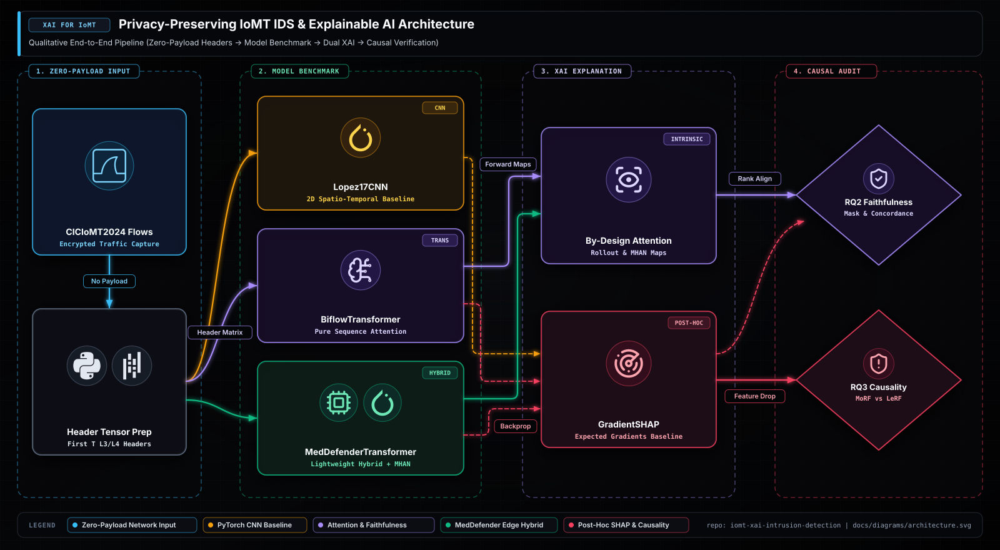

# Explainable AI (XAI) for Early Intrusion Detection in IoMT Networks

An experimental PyTorch benchmark and Explainable AI (XAI) evaluation framework for **early bidirectional flow (biflow) intrusion detection** in **Internet of Medical Things (IoMT)** networks using only **first-$T$ ($T=10$) packet L3/L4 header metadata** ($F=6$ privacy-preserving fields).

> **Academic context:** Developed at **DIETI — University of Naples Federico II** by **Giuseppe Ruggiero**, **Francesco Marotta**, and **Marco Rauccio** (*Data Analysis and Cybersecurity* project & accompanying IEEE research study).

---

## Key Contributions



*[High-resolution PNG version](docs/diagrams/architecture.png)*

1. **Privacy-Preserving Early Classification (`CICIoMT2024`, 13 classes):** Evaluates three deep learning architectures on `181,366` test biflows using zero-payload header features (`PL`, `IAT`, `DIR`, `WIN`, `TTL`, `FLG`) over the first $T=10$ packets (`63% / 7% / 30%` stratified train/val/test split, `seed=0`).
2. **Architectures Benchmarked:**
   - **`Lopez17CNN`:** 2D-CNN baseline over $(T \times F)$ flow matrices (`787,741` parameters, `3.00 MB`).
   - **`BiflowTransformer`:** Pure Transformer encoder with learnable `CLS` token and **Attention Rollout** (`425,981` parameters, `1.62 MB`).
   - **`MedDefenderTransformer`:** Lightweight dual-stream hybrid (`1D-CNN` + `Transformer` + **Multi-Head Attention Pooling / MHAN**, `353,085` parameters, `1.35 MB` — **55% fewer parameters** than `Lopez17CNN`).
3. **Formal XAI Faithfulness & Causal Audit ($N=957$ explained flows):**
   - Compares **By-Design Attention** (`Attention Rollout`, `MHAN`) against **Post-Hoc GradientSHAP** (`Expected Gradients`) using **Spearman rank correlation ($\rho$)**, **Cosine Similarity**, **Edge Inference Latency**, **Temporal Masking**, and **Frozen-Model MoRF vs. LeRF Perturbation (AUDC)**.
4. **Hardened Codebase & Edge Profiling:** Uses safe checkpoint loading (`weights_only=True` when supported), multi-layer `MedDefenderTransformer` support (`nlayers >= 1`) preserving 1-layer checkpoint compatibility, OS-independent metrics aggregation, and a 10-test unit suite (`src/tests/test_networks.py`).

---

## Certified Experimental Results

Full tabulated numbers are also archived in [`results/final_experimental_report.md`](results/final_experimental_report.md).

### 1. Classification & Single-Thread Edge CPU Latency (13-Class CICIoMT2024, $N=181,366$)

| Run ID | Architecture | Macro-F1 (%) | Balanced Acc (%) | Params | Size (MB) | Median CPU Latency | P95 Latency | Throughput |
| :--- | :--- | ---: | ---: | ---: | ---: | ---: | ---: | ---: |
| `S2_R01` | `Lopez17CNN` | **84.76** | **86.07** | 787,741 | 3.00 | **1.03 ms** | **1.63 ms** | **975.2 fps** |
| `S2_R02` | `BiflowTransformer` | 74.40 | 76.91 | 425,981 | 1.62 | 2.48 ms | 4.40 ms | 404.0 fps |
| `S2_R03` | `MedDefenderTransformer` | 74.46 | 76.91 | **353,085** | **1.35** | 2.10 ms | 3.40 ms | 475.7 fps |

### 2. By-Design Attention vs. Post-Hoc GradientSHAP Audit ($N=957$ Flows)

| Model | Explanation Method | Spearman $\rho$ (vs SHAP) | Cosine Sim (vs SHAP) | Per-Flow Latency | Top-3 Temporal Masking ($\Delta$ F1) |
| :--- | :--- | :--- | :--- | :--- | :--- |
| `Lopez17CNN` | GradientSHAP (Post-Hoc) | N/A | N/A | 1.16 s | -76.3 p.p. |
| `BiflowTransformer` | GradientSHAP (Post-Hoc) | 1.000 | 1.000 | 1.40 s | -68.7 p.p. |
| `BiflowTransformer` | Attention Rollout (By-Design) | 0.222 | **0.876** | **2.48 ms** | -67.2 p.p. |
| `MedDefenderTransformer` | GradientSHAP (Post-Hoc) | 1.000 | 1.000 | 1.32 s | -59.0 p.p. |
| `MedDefenderTransformer` | MHAN Attention (By-Design) | **0.290** | 0.771 | **2.10 ms** | -55.0 p.p. |

### 3. Causal Validation on Frozen Models (MoRF / LeRF)

| Model | Top-1 Occluded Field | MoRF $k=1$ Macro-F1 ($\Delta$ F1) | MoRF $k=3$ Macro-F1 ($\Delta$ F1) | AUDC MoRF ($\downarrow$) | AUDC LeRF ($\uparrow$) |
| :--- | :--- | :--- | :--- | ---: | ---: |
| `Lopez17CNN` | `DIR` | 64.59% (-20.17 p.p.) | 1.46% (-83.30 p.p.) | 22.44 | **21.29** |
| `BiflowTransformer` | `TTL` | 2.13% (-72.28 p.p.) | 0.22% (-74.18 p.p.) | **8.86** | 9.18 |
| `MedDefenderTransformer` | `TTL` | 26.64% (-47.83 p.p.) | 0.62% (-73.84 p.p.) | 15.43 | 14.44 |

**Key takeaway:** Zero-overhead by-design attention mechanisms achieve sub-3 ms inference (vs. `1.16–1.40 s` for GradientSHAP, an ~550x speedup) while strongly identifying critical causal packets (`-67.2` to `-55.0` p.p. drop upon Top-3 masking), yet remain only weakly rank-correlated with input-level SHAP attributions ($\rho = 0.222–0.290$).

---

## Repository Structure

```text
iomt-xai-intrusion-detection/
├── .gitattributes
├── .gitignore
├── LICENSE
├── requirements.txt                      # Core PyTorch, scientific stack & training dependencies
├── requirements-xai.txt                  # Explainability dependencies (SHAP, Captum, LIME, UMAP, tabulate)
├── data/
│   ├── classes.txt                       # 13 CICIoMT2024 traffic/attack class labels
│   └── label_conv.json                   # Attack-type to integer class mapping
├── docs/
│   └── diagrams/                         # Dark-theme vector SVG & high-DPI PNG pipeline diagrams
├── notebooks/
│   ├── 01_data_preparation.ipynb         # Dataset inspection, 63/7/30 split & cold-cache validation
│   ├── 02_train_benchmark.ipynb          # Training summary, confusion matrices & learning curves
│   ├── 03_xai_extraction.ipynb           # GradientSHAP, Attention Rollout & MHAN extraction
│   ├── 04_xai_audit.ipynb                # Formal concordance & temporal sanity audit
│   ├── 05_inference_masking.ipynb        # Causal MoRF/LeRF occlusion & latency benchmarking
│   └── 06_visualizations_reporting.ipynb # Publication-grade plots & summary tables
├── results/
│   └── final_experimental_report.md      # Certified quantitative benchmark & XAI summary
├── scripts/
│   ├── run_training.sh                   # Reproducible Focal Loss + AdamW/SGD training CLI
│   ├── launch_batch_training.sh          # Full 3-model batch wrapper (seed=0, 50 epochs)
│   ├── profile_latency.py                # Single-thread CPU edge latency & throughput benchmark
│   ├── rq2_sanity_baselines.py           # Positional (1/t) & random baseline audit for RQ2
│   └── generate_paper_figures_bilingual.py # Vector PDF/PNG IEEE figure generator
└── src/
    ├── main.py                           # FACIL-based training/eval entrypoint
    ├── compute_metrics.py                # Per-class Macro-F1 / Recall parquet aggregator
    ├── utils.py                          # Seeding, summary printing & safe checkpoint loader
    ├── approach/                         # Training loop (`scratch.py`, `incremental_learning.py`)
    ├── datasets/                         # `networking_dataset.py` biflow loader & `dataset_config.py`
    ├── loggers/                          # Disk & TensorBoard experiment loggers
    ├── networks/                         # `lopez17cnn.py`, `transformer.py`, `network.py` (`LLL_Net`)
    ├── tests/
    │   └── test_networks.py              # 10-case architecture & XAI unit test suite
    ├── util/
    │   └── xai_utils.py                  # Instance normalization & 3-level AFA pooling
    └── xai/
        ├── model_loader.py               # Checkpoint & hyperparameter loader (`weights_only=True`)
        └── xai_metrics.py                # Spearman rho, Cosine Sim, field SHAP & AUDC
```

---

## Setup & Reproduction

### 1. Installation
```bash
python -m venv .venv
# Linux/macOS: source .venv/bin/activate
# Windows PowerShell: .venv\Scripts\Activate.ps1

pip install -r requirements.txt
pip install -r requirements-xai.txt   # Optional: required for XAI extraction notebooks
```

### 2. Run Unit Tests (No External Dataset Required)
Verify all architectures (`Lopez17CNN`, `BiflowTransformer`, `MedDefenderTransformer`), `LLL_Net` serialization, 3-level AFA decomposition, alignment metrics, AUDC computation, and cold-cache preprocessing:
```bash
python src/tests/test_networks.py
```

### 3. Dataset Placement (`CICIoMT2024`)
Raw `.parquet` files are excluded from Git tracking due to size. To reproduce full training and XAI extraction:
1. Obtain the preprocessed bidirectional flow `.parquet` files for **CICIoMT2024** (`10`-packet headers: `PL`, `IAT`, `DIR`, `WIN`, `TTL`, `FLG`).
2. Configure paths in `src/datasets/dataset_config.py` (or place your parquet dataset under `data/`).

### 4. Training, Profiling & Notebook Workflow
```bash
# Dry-run the training protocol
bash scripts/run_training.sh --all --cpu --dry-run

# Train all three architectures (GPU, seed=0, 50 epochs)
bash scripts/run_training.sh --all --gpu

# Profile single-thread edge CPU latency
python scripts/profile_latency.py --results-dir results

# Execute notebooks sequentially: 01_data_preparation -> 06_visualizations_reporting
```

---

## License

Released under the terms of [`LICENSE`](LICENSE).

